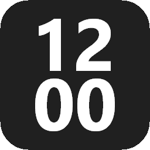
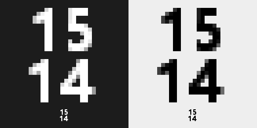

<p align="center">
  
</p>

<h1 align="center">UTC Time Widget</h1>

<p align="center">
  A tiny Windows tray clock that shows the current <b>UTC</b> time, in a single dependency-free executable.
</p>

<p align="center">
  <a href="releases/v1.0.0/utc-time-widget.exe"></a>
  
  
  <a href="LICENSE"></a>
  
</p>

---

**UTC Time Widget** puts the current UTC time into the Windows notification area, with the hour on top and the minute below. It has no windows and no settings, and it is a single ~2 MB `.exe` with zero runtime dependencies.

> [!NOTE]
> **This app has been vibe-coded.** It was written almost entirely by an AI coding assistant ([Claude Code](https://claude.com/claude-code)) from a short natural-language description, then tested and reviewed by a human. Keep that in mind and review the code before you rely on it for anything important.

<p align="center">
  
</p>

## Features

- 🕒 **UTC at a glance:** the hour (24h) and minute are stacked in the square tray icon.
- 🖱️ **Minimal UI:** right-click shows a single **Exit** item, and hovering shows the UTC time and date.
- 🚀 **Starts with Windows:** the app registers itself for the current user and needs no admin rights.
- 🌓 **Theme aware:** the digits are white on a dark taskbar and black on a light one, and they switch live.
- 🔍 **Always crisp:** the icon is drawn pixel-exact for the taskbar's DPI (100 %, 125 %, 150 %, 200 %, …).
- 📦 **Zero dependencies:** a single statically linked Go executable with no Go runtime, .NET, Java, VC++ redistributable or DLLs.
- 🪶 **Lightweight:** it uses ~12 MB of RAM and wakes up about once a second.
- 🛡️ **Robust:** only one instance runs at a time, and the icon comes back by itself after Explorer restarts.

## Installation

1. Download [`releases/v1.0.0/utc-time-widget.exe`](releases/v1.0.0/utc-time-widget.exe) (see [all releases](releases/)).
2. Put it somewhere permanent, for example `%LOCALAPPDATA%\Programs\utc-time-widget\`.
3. Double-click it. From then on it starts automatically when you log on.

> [!TIP]
> Windows 11 initially puts new tray icons into the overflow flyout (the `^` button). To keep the clock visible, drag it onto the taskbar, or enable it under **Settings › Personalization › Taskbar › Other system tray icons**.

> [!IMPORTANT]
> The executable is not code-signed. On first start, Windows SmartScreen may show *"Windows protected your PC"*. Click **More info › Run anyway**, or build it yourself (see below).

To verify the download, compare its hash with the `SHA256SUMS` file next to it:

```powershell
Get-FileHash .\utc-time-widget.exe -Algorithm SHA256
```

## Usage

| Action                         | How                                                   |
|--------------------------------|-------------------------------------------------------|
| Show date and time as text     | Hover over the icon                                   |
| Quit                           | Right-click the icon › **Exit**                       |
| Disable autostart temporarily  | Task Manager › Startup apps › *UTC Time Widget*       |
| Remove autostart               | `utc-time-widget.exe -remove-autostart`               |
| Show the version               | `utc-time-widget.exe -version`                        |

Autostart is a value named `utc-time-widget` under `HKCU\Software\Microsoft\Windows\CurrentVersion\Run`. The app writes it each time it starts, so if you move the `.exe`, just start it once from its new location.

### Uninstall

1. Right-click the icon › **Exit**.
2. Run `utc-time-widget.exe -remove-autostart`.
3. Delete the `.exe`.

## Building from source

You don't need a local Go installation. Go runs in a throw-away Docker container and cross-compiles a Windows executable.

### Prerequisites

- **Windows 10/11** with **PowerShell 5.1** or newer (to run `build.ps1` and the tests).
- **[Docker Desktop](https://www.docker.com/products/docker-desktop/)** using Linux containers (the default WSL 2 backend is fine). The drive holding the repository must be shared with Docker, which is the default with the WSL 2 backend.
- Internet access on the first build, to pull the `golang:1.26` image and download the Go modules.

### Go caches (Docker volumes)

Each build runs in a fresh container (`docker run --rm`), so Go's caches would normally be thrown away after every build. To keep builds fast, `build.ps1` mounts two **named Docker volumes**:

| Volume           | Mounted at                | Contents                                     |
|------------------|---------------------------|----------------------------------------------|
| `go-mod-cache`   | `/go/pkg/mod`             | Downloaded Go modules (`golang.org/x/sys`, the `go-winres` tool) |
| `go-build-cache` | `/root/.cache/go-build`   | Compiled packages for incremental builds     |

Docker creates them automatically on first use, so no setup is required. To create them up front, or to share them with other Go projects that use the same names:

```powershell
docker volume create go-mod-cache
docker volume create go-build-cache
```

If a build ever behaves strangely, reset the caches:

```powershell
docker volume rm go-build-cache go-mod-cache
```

### Build

```powershell
git clone https://github.com/TomLadek/utc-time-widget.git
cd utc-time-widget
.\build.ps1          # gofmt check, go vet, build .\utc-time-widget.exe
.\build.ps1 -Test    # ... and run the tests on Windows
```

If script execution is blocked, run `powershell -ExecutionPolicy Bypass -File .\build.ps1`.

Under the hood, `build.ps1` does three things:
1. It uses [`go-winres`](https://github.com/tc-hib/go-winres) to generate the Windows resources (icon, version info, DPI-aware manifest).
2. It runs `go build` with `CGO_ENABLED=0`, `-trimpath` and `-ldflags "-s -w -H=windowsgui -X main.version=…"`. The result is a stripped GUI-subsystem binary that opens no console window and contains no paths from the build machine.
3. Because the tests use Windows GDI, it cross-compiles them with `go test -c` and runs the test binary on the host.

If you're not on Windows (for example in WSL or on Linux), you can still build the executable without the resources and tests:

```sh
docker run --rm -v "$PWD:/src" -w /src \
  -v go-build-cache:/root/.cache/go-build -v go-mod-cache:/go/pkg/mod \
  -e GOOS=windows -e GOARCH=amd64 -e CGO_ENABLED=0 \
  golang:1.26 go build -trimpath -ldflags="-s -w -H=windowsgui" -o utc-time-widget.exe .
```

### Regenerating images

[`assets/app-icon.png`](assets/app-icon.png) (the `.exe` icon) and [`docs/icon-preview.png`](docs/icon-preview.png) are generated with the same renderer the app uses:

```powershell
docker run --rm -v "${PWD}:/src" -w /src -v go-build-cache:/root/.cache/go-build -v go-mod-cache:/go/pkg/mod `
  -e GOOS=windows -e CGO_ENABLED=0 golang:1.26 go test -c -o utc-time-widget.test.exe .
$env:GENERATE_ASSETS = 1; .\utc-time-widget.test.exe '-test.run=TestGenerateAssets'
# With $env:ICON_PREVIEW_DIR set to a folder, '-test.run=TestPreview' compares candidate fonts.
```

## Versioning and releases

The project follows [Semantic Versioning](https://semver.org/).
- The current version is stored in [`VERSION`](VERSION).
- Release notes are kept in [`CHANGELOG.md`](CHANGELOG.md) (format: [Keep a Changelog](https://keepachangelog.com/)).
- Released binaries are committed under [`releases/`](releases/), one directory per version, each with a `SHA256SUMS` file.

To cut a release:
1. Move the entries under `## [Unreleased]` in `CHANGELOG.md` to a new `## [X.Y.Z] - YYYY-MM-DD` section, and update the comparison links at the bottom.
2. Put `X.Y.Z` into `VERSION`, and update the version badge and download link at the top of this README.
3. Run `.\build.ps1 -Release`. It runs the tests, builds, and writes `releases\vX.Y.Z\` (exe and `SHA256SUMS`). It refuses to run if that directory already exists or if `CHANGELOG.md` has no section for the version.
4. Commit, tag and push:
   ```powershell
   git add -A
   git commit -m "Release vX.Y.Z"
   git tag -a vX.Y.Z -m "vX.Y.Z"
   git push --follow-tags
   ```
5. Optionally, create a GitHub Release from the tag, paste the changelog section, and attach the exe.

## How it works

- **Window and tray icon:** a hidden top-level window (never shown) owns the tray icon (`Shell_NotifyIconW`, `NOTIFYICON_VERSION_4`) and receives broadcasts such as `TaskbarCreated` and `WM_SETTINGCHANGE`.
- **Drawing the digits:** the hour and minute are drawn with GDI in *Segoe UI Bold* with grayscale anti-aliasing. The glyph coverage becomes the alpha channel of a 32-bit icon, so the digits blend cleanly onto any taskbar. The font size is the largest one whose digits fit their half of the icon.
- **Icon size:** this is the small-icon size (`SM_CXSMICON`) at the DPI of the monitor showing the taskbar, re-checked on every tick.
- **Timer:** it fires at the next minute boundary, or at least once a second, so theme, DPI and clock changes show up promptly.
- **Win32 access:** everything goes through [`golang.org/x/sys/windows`](https://pkg.go.dev/golang.org/x/sys/windows), with system DLLs loaded only from `System32`. There is no cgo and no GUI framework.

| File                             | Purpose                                                                 |
|----------------------------------|-------------------------------------------------------------------------|
| [`main.go`](main.go)             | Startup, flags, hidden window, message loop, tray icon, menu, timer     |
| [`icon.go`](icon.go)             | Renders the two rows of digits into a 32-bit alpha icon                 |
| [`autostart.go`](autostart.go)   | Adds or removes the per-user `Run` registry entry                       |
| [`win32.go`](win32.go)           | Minimal Win32 bindings (user32, gdi32, shell32)                         |
| [`icon_test.go`](icon_test.go)   | Layout test for every minute of the day at several sizes, plus image generators |
| [`build.ps1`](build.ps1)         | Docker-based build, test and release script                             |

## License

[MIT](LICENSE) © Tom Ladek
